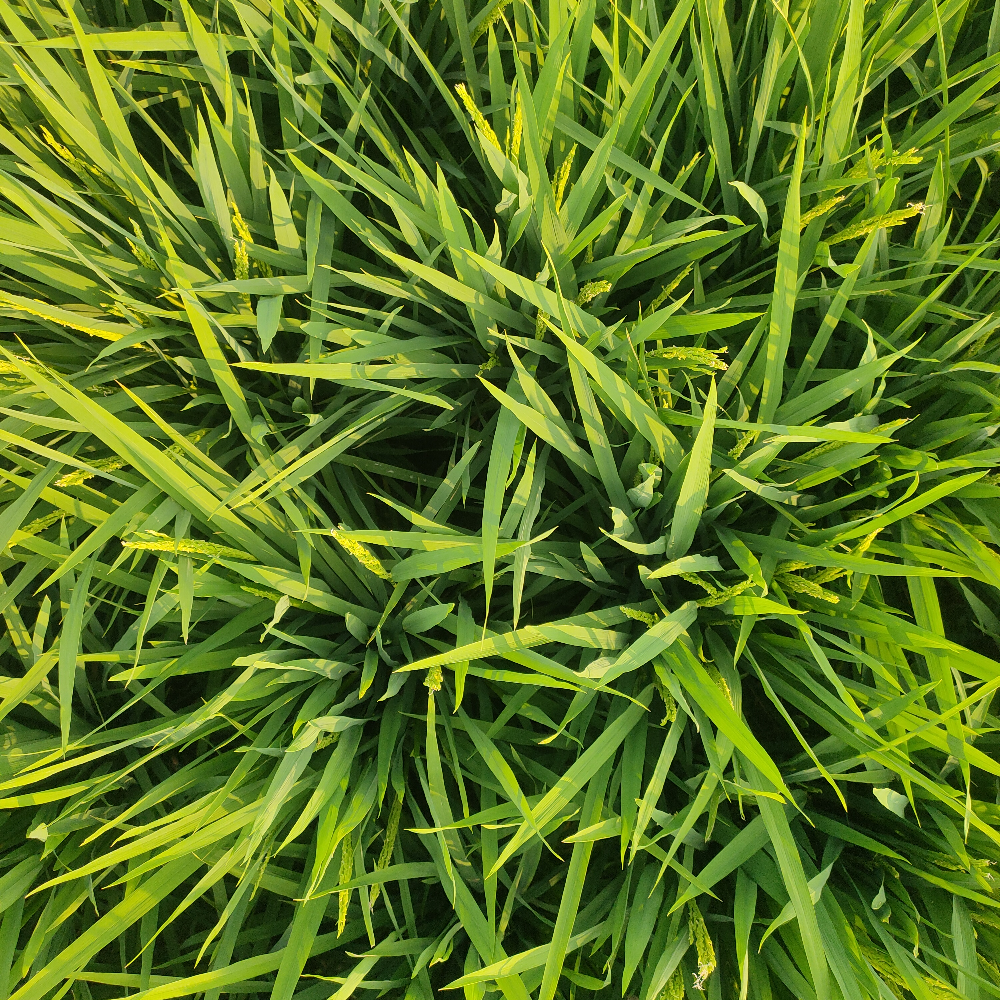
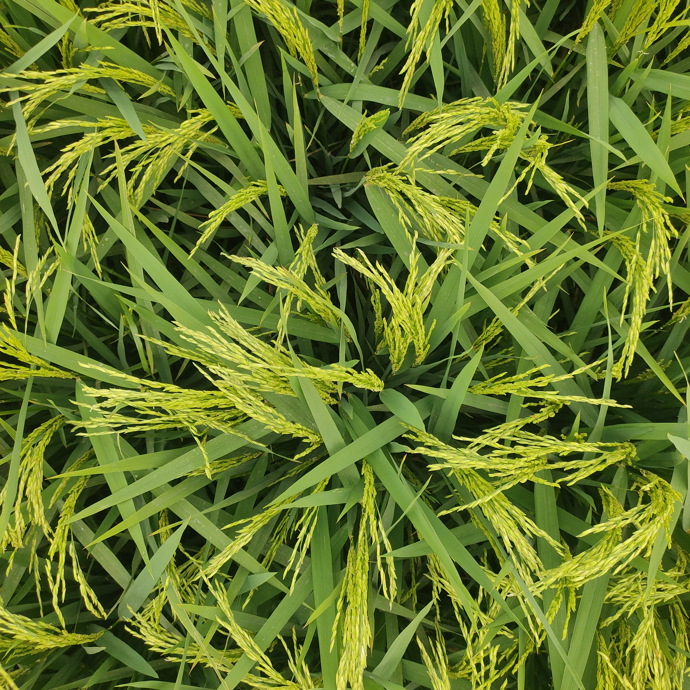
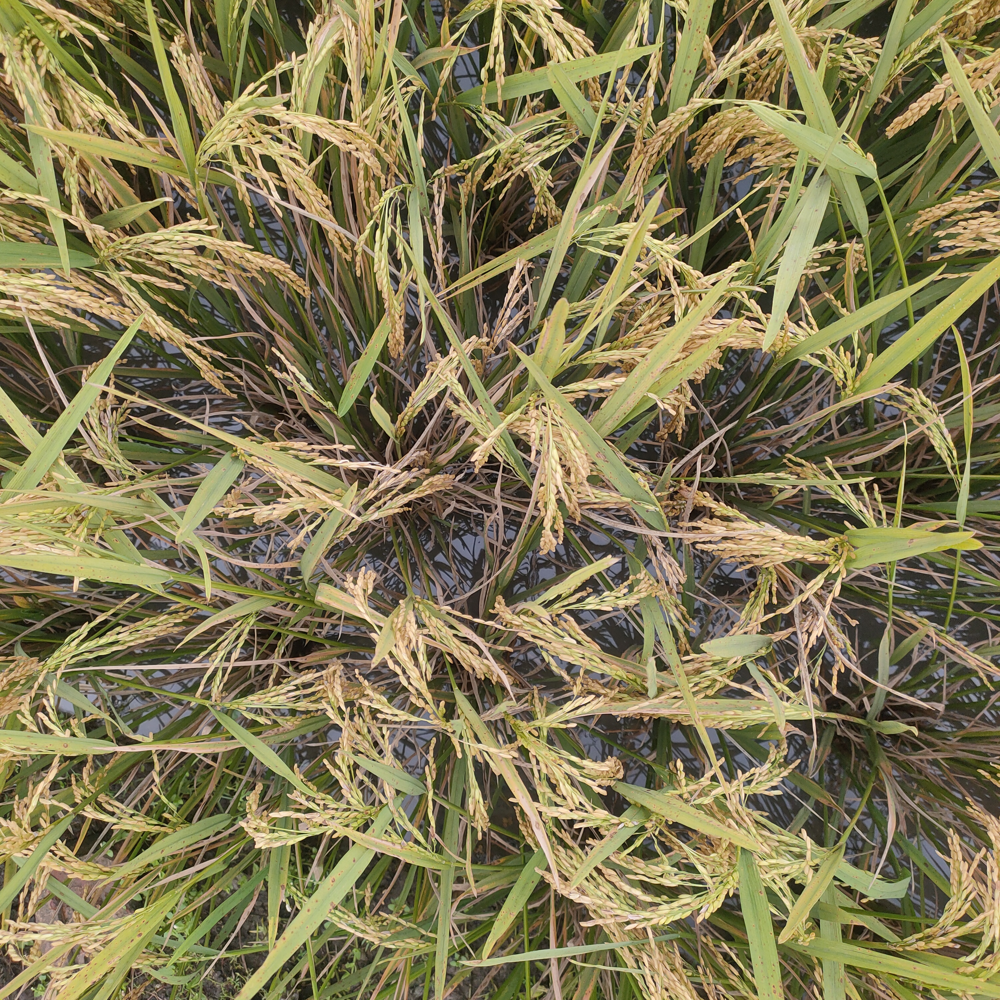

# Rice Panicle Detection and Growth-Stage Recognition

A computer vision research project on detecting rice panicles and recognising rice growth stages from field images.

**Status:** Ongoing. Data collection is complete and annotation is in progress. No model results have been produced yet.

**Supervisor:** Dr. Umme Fawzia Rahim, Assistant Professor, Department of CSE, Dhaka University of Engineering & Technology (DUET), Gazipur, Bangladesh

**Author:** Md Sayedul Islam, B.Sc. in Computer Science and Engineering (expected 2027), DUET

---

## Motivation

Rice is the staple crop of Bangladesh. Automatically recognising the growth stage of rice from images could help farmers monitor their fields more consistently. For this to be useful in practice, the models must also run where farmers are: on a phone or a low-cost device. This project therefore combines two goals:

1. Detect rice panicles and recognise their growth stage from images.
2. Make the vision models lightweight and resource-efficient enough for devices with limited computing power.

## Dataset

I am building the dataset from scratch.

| Item | Details |
|---|---|
| Growth stages | 3: booting, heading, maturity |
| Images per stage | 1,500 |
| Total images | 4,500 |
| Capture device | Phone camera |
| Viewpoint | Drone-style aerial viewpoint (no drone used) |
| Annotation tool | [CVAT](https://www.cvat.ai/) |
| Annotation status | In progress |

The classes are balanced, with the same number of images for each growth stage.

## Sample Images

| Booting | Heading | Maturity |
|:---:|:---:|:---:|
|  |  |  |

## Progress

- [x] Collect images for three growth stages (4,500 images)
- [ ] Annotate all images in CVAT (in progress)
- [ ] Split the data into training, validation and test sets
- [ ] Train and evaluate Python-based machine learning and deep learning models for panicle detection and growth-stage recognition
- [ ] Explore lightweight, resource-efficient vision models
- [ ] Integrate the AI workflow into an Android application

## Planned approach

- Python-based machine learning, deep learning and computer vision methods for detection and stage recognition.
- Evaluation of lightweight models, with attention to the trade-off between accuracy and computing cost.
- Integration of the final workflow into an Android application for practical use.

## Repository contents

This repository currently documents the project. Code, annotation guidelines and results will be added as the work progresses.

## Contact

Md Sayedul Islam
Email: mdsayedul764@gmail.com
LinkedIn: [linkedin.com/in/saidul07](https://www.linkedin.com/in/saidul07/)
GitHub: [github.com/saidul-07](https://github.com/saidul-07)
